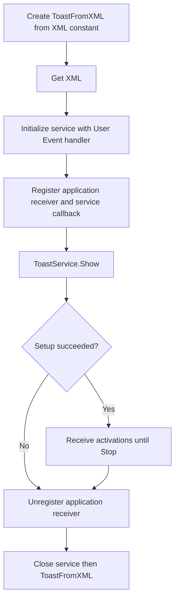

# Display a toast from XML

Open `Sources/ToastAPI.lvproj`, then `Examples/Toast From XML.vi`.
This example selects Create ToastFromXML in Create ToastSource (Poly). It uses
the same ToastService and UserEventActivationHandler as the reply example.

## Try it

1. Run the VI. The XML diagram constant creates the notification below.
2. Type a reason and click **Send**.
3. Inspect Activation: Arguments should be `action=reject&requestId=42` and
   User Inputs should contain Key `Reason` with the submitted Value.
4. Press **stop** to leave the receiving loop and close the service and source.

```xml
<toast launch="action=open&amp;requestId=42">
  <visual>
    <binding template="ToastGeneric">
      <text>Request #42 - XML</text>
      <text>Why do you reject this request?</text>
    </binding>
  </visual>
  <actions>
    <input id="Reason" type="text" placeHolderContent="Enter your reason"/>
    <action content="Send" arguments="action=reject&amp;requestId=42"/>
  </actions>
</toast>
```

In XML attributes, `&amp;` encodes the literal `&` returned in activation
arguments. `Reason` is the input key; the button's arguments identify the action.
The **Toast XML** indicator shows DOM serialization, which may change formatting.

## Call sequence



The XML source remains caller-owned. The example does not load a file or perform
template substitution. Closing the source releases its document; it does not
dismiss a notification already delivered to Windows. The example also retains
the existing .NET collection workaround for callback reservation.

## Validation and remaining checks

The maintainer confirmed successful operation after correcting Invoke Object
Method to invoke the actual object instead of its System.Type. No new runtime
test was performed during the documentation pass. Empty replies, special
characters, notification-history activation and repeated Start/Stop should be
checked specifically on this XML path before claiming the reply example's full
validation coverage. Malformed-XML construction currently has a known
[partial-failure cleanup limitation](/coverage.md).

[ToastFromXML](/api/toastfromxml.md) · [Text reply](/guides/reply.md) ·
[Callbacks and ownership](/callbacks.md)
