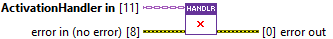
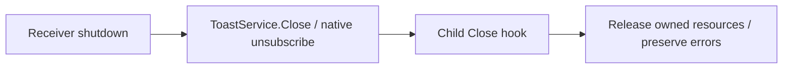

> **Lifecycle hook:** invoked by ToastService.Close. Override it in your child;
> in the service workflow, do not also close the handler manually.
> [See the lifecycle sequence](/api/activationhandler.md?id=hooks-orchestrated-by-toastservice).

## Connector

## Inputs and outputs

| Input | Type | Default | Use |
|---|---|---|---|
| `ActivationHandler in` | ActivationHandler | Base handler | Dynamic-dispatch value whose child may own resources. |
| `error in (no error)` | Error cluster | No error | Primary error to retain during cleanup. |

| Output | Type | Use |
|---|---|---|
| `error out` | Error cluster | Unchanged incoming error/warning in the base implementation. |

## Typical call sequence

## Usage notes

- The base hook has no owned resources and no cleanup action. Both Error/No
  Error cases pass the error through. This is not a guarantee that an arbitrary
  child override will clean up correctly.
- Override Close to release what the child Initialize acquired. Attempt cleanup
  even on incoming error and merge the primary error before cleanup failures.
  Leave injected application-owned references to their owner unless ownership
  transfer is an explicit part of your child contract.
- With ToastService, let the service invoke the hook; do not also close the same
  handler manually. The hook has no handler output and does not automatically
  clear reference fields in other class copies.
- Coordinate shutdown before destroying resources that callbacks can still
  use. Native unsubscription alone does not establish callback completion.
  [ToastService.Close](/reference/toastservice/close.md) presents the shutdown
  order; lifetime hardening remains tracked in
  [issue #16](https://github.com/loicwoh/ToastNotifications/issues/16).
- Close runs outside Handle Activation. Do not use garbage collection as a
  substitute for releasing events, queues or native subscriptions.

## Related reading

[ActivationHandler](/api/activationhandler.md) · [Initialize](/reference/activationhandler/initialize.md) ·
[User Event Close](/reference/usereventactivationhandler/close.md) · [Ownership](/callbacks.md)
