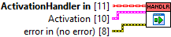
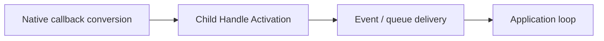

## Connector

## Inputs and outputs

| Input | Type | Default | Use |
|---|---|---|---|
| `ActivationHandler in` | ActivationHandler | Base handler | Dynamic-dispatch input supplied by callback registration. |
| `Activation` | Activation cluster | Empty Arguments and User Inputs | Converted LabVIEW payload; contains no .NET references. |
| `error in (no error)` | Error cluster | No error | Error from native-to-LabVIEW activation conversion. |

**No connector outputs.** This method returns neither a modified handler nor an
error cluster to the caller. The saved short description's wording about
propagating an error does not imply an error output: the base diagram consumes
the inputs without processing or forwarding them.

| Activation field | Type | Meaning |
|---|---|---|
| `Arguments` | String | Raw activation string supplied by the clicked application action or toast body. |
| `User Inputs` | Array of Key/Value String clusters | Submitted input IDs and values; separate from Arguments. |

## Typical call sequence

## Usage notes

- The base method is an empty extension point. Create a child override to react;
  selecting the base handler alone does not display a dialog or deliver a reply.
- The callback uses the handler value stored by
  [Register For Events](/reference/toastservice/register-for-events.md).
  Later changes to a separate class wire are not automatically written into
  that registered value. Reference-based communication supplies shared state.
- Choose your error policy explicitly in the override. The
  [User Event implementation](/reference/usereventactivationhandler/handle-activation.md)
  forwards conversion errors as payload instead of suppressing delivery.
  There is no error output here to report a failed delivery synchronously.
- Parse Arguments only according to the format your application assigned;
  the toolkit does not turn `action=open&requestId=42` into typed parameters.
  Match User Inputs by Key, not by an assumed array index. Empty input text is
  a valid String value; consult the [reply example](/guides/reply.md).
- Return promptly. Move UI work and long operations to the receiver. Do not wait
  for that loop or call ToastService.Close from inside this callback.
- This hook receives application activations. A protocol button opens its URI
  through Windows instead of invoking this hook for that button.

## Related reading

[ActivationHandler](/api/activationhandler.md) · [Initialize](/reference/activationhandler/initialize.md) ·
[User Event delivery](/reference/usereventactivationhandler/handle-activation.md) ·
[Callbacks and ownership](/callbacks.md)
