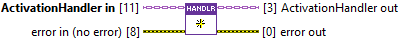
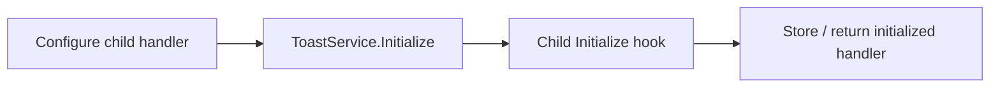

> **Lifecycle hook:** invoked by ToastService.Initialize. Override it in your child;
> in the service workflow, do not call it separately from the application.
> [See the lifecycle sequence](/api/activationhandler.md?id=hooks-orchestrated-by-toastservice).

## Connector

## Inputs and outputs

| Input | Type | Default | Use |
|---|---|---|---|
| `ActivationHandler in` | ActivationHandler | Base handler | Dynamic-dispatch input; the runtime child class selects its override. |
| `error in (no error)` | Error cluster | No error | Setup error passed to the hook. |

| Output | Type | Use |
|---|---|---|
| `ActivationHandler out` | ActivationHandler | Unchanged by the base implementation; overrides return their initialized value. |
| `error out` | Error cluster | Unchanged incoming error/warning in the base implementation. |

## Typical call sequence

## Usage notes

- The base hook owns no resources. Its Error/No Error cases both pass the
  handler and error through. Implement acquisition in a child override and
  matching cleanup in [Close](/reference/activationhandler/close.md).
- Let [ToastService.Initialize](/reference/toastservice/initialize.md) invoke
  the hook. Calling it separately and then passing the already initialized
  handler to the service can acquire resources twice.
- In an override, normally skip acquisition on incoming error. Return the child
  value containing the references needed by Handle Activation, and define
  cleanup for partial initialization failures.
- Configure application-owned dependencies through your child API before
  injection. If the hook creates resources, expose only the references the
  receiver needs through read-only properties, as the
  [User Event plugin](/api/usereventactivationhandler.md) does.
- The returned handler is a LabVIEW class value. Its reference fields can alias
  shared resources; copying it does not create a second independent lifecycle.

## Related reading

[ActivationHandler](/api/activationhandler.md) · [Handle Activation](/reference/activationhandler/handle-activation.md) ·
[User Event Initialize](/reference/usereventactivationhandler/initialize.md) · [Ownership](/callbacks.md)
