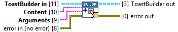
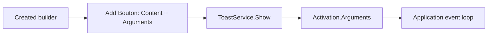

## Connector

## Inputs and outputs

| Input | Type | Default | Use |
|---|---|---|---|
| `ToastBuilder in` | ToastBuilder | Uninitialized | A created, live builder. |
| `Content` | String | Empty | Visible button label, for example `Send`. |
| `Arguments` | String | Empty | Raw activation string, for example `action=reject&requestId=42`. |
| `error in (no error)` | Error cluster | No error | Incoming error chain. |

| Output | Type | Use |
|---|---|---|
| `ToastBuilder out` | ToastBuilder | Aliases the input native builder; button added on success. |
| `error out` | Error cluster | Button creation/addition result or propagated incoming error. |

## Typical call sequence

For distinct actions, see [multiple actions](/guides/multiple-actions.md). For a
Send button accompanying a text field, see [the reply example](/guides/reply.md).

## Usage notes

- Content is the label the user sees. Arguments is application-defined routing
  data; it is not automatically the label and is not a submitted text-field value.
- This overload exposes no activation-type selector or text-input association.
  Use [Add Link Button](/reference/toastbuilder/add-link-button.md) for a URI action.
  Body-click arguments are configured separately by
  [Set Activation Arguments](/reference/toastbuilder/set-activation-arguments.md).
- The wrapper performs no local parsing or encoding of the argument string.
  Inspect [Get XML](/reference/toastbuilder/get-xml.md) and check errors before Show.
- The method releases its temporary native button reference after attempting to
  add the button. Close the builder after its last use.

## Related reading

[ToastBuilder](/api/toastbuilder.md) · [Add Text Input](/reference/toastbuilder/add-text-input.md) ·
[Activation data](/concepts.md?id=activation) · [Ownership](/callbacks.md)
