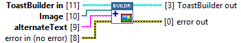
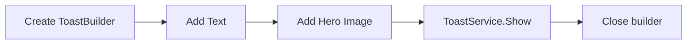

## Connector

## Inputs and outputs

| Input | Type | Use |
|---|---|---|
| `ToastBuilder in` | ToastBuilder | A created, live builder. |
| `Image` | Path | Absolute path to a local image file. |
| `alternateText` | String | Optional description for assistive technology. |
| `error in (no error)` | Error cluster | Incoming error chain. |

| Output | Type | Use |
|---|---|---|
| `ToastBuilder out` | ToastBuilder | The same builder, modified on success. |
| `error out` | Error cluster | Result of the operation or the incoming error. |

## Typical call sequence

## Usage notes

- The wrapper converts the local path to a file URI. Windows reads the file when rendering the notification, so keep it available while the toast can be displayed.
- Check the path and file if the toast displays without its image. A successful `Show` does not confirm that Windows rendered the image.

[Result preview example](/guides/images.md)
