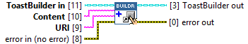
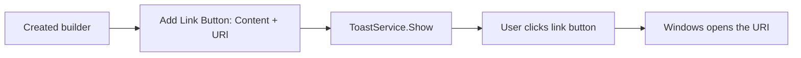

## Connector

## Inputs and outputs

| Input | Type | Default | Use |
|---|---|---|---|
| `ToastBuilder in` | ToastBuilder | Uninitialized | A created, live builder. |
| `Content` | String | Empty | Visible label, for example `Open project on GitHub`. |
| `URl` | String | Empty | URI opened by Windows, for example `https://github.com/loicwoh/ToastNotifications`. |
| `error in (no error)` | Error cluster | No error | Incoming error chain. |

| Output | Type | Use |
|---|---|---|
| `ToastBuilder out` | ToastBuilder | The same native builder, modified on success. |
| `error out` | Error cluster | Native result or propagated incoming error. |

## Typical call sequence

The [protocol example](/guides/protocol.md) contains the complete runnable scenario.

## Usage notes

- `URl` is the saved terminal spelling. It is a LabVIEW String, not a System.Uri
  object. Supply an absolute HTTPS URL for an ordinary web link.
- The method fixes Protocol activation. This button click is handled by Windows
  and does not invoke the application's ActivationHandler for that action.
  A click on the toast body remains a separate activation.
- For an application command or a submitted reply, use
  [Add Bouton](/reference/toastbuilder/add-bouton.md).
- URI validation and errors are delegated to the toolkit and Windows. This call
  does not register callbacks or close the builder. Close its owner after final use.

## Related reading

[ToastBuilder](/api/toastbuilder.md) · [Set Activation Arguments](/reference/toastbuilder/set-activation-arguments.md) ·
[Activation concepts](/concepts.md?id=activation) · [Protocol example](/guides/protocol.md)
