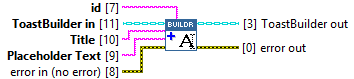
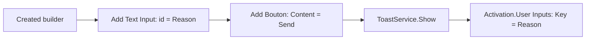

## Connector

## Inputs and outputs

| Input | Type | Default | Use |
|---|---|---|---|
| `ToastBuilder in` | ToastBuilder | Uninitialized | A created, live builder. |
| `id` | String | Empty | Field identifier matched against `Activation.User Inputs.Key`, for example `Reason`. |
| `Title` | String | Empty | Visible label above the field. |
| `Placeholder Text` | String | Empty | Hint while the field is empty; not a prefilled reply. |
| `error in (no error)` | Error cluster | No error | Incoming error chain. |

| Output | Type | Use |
|---|---|---|
| `ToastBuilder out` | ToastBuilder | The same native builder, with the input added on success. |
| `error out` | Error cluster | Native result or propagated incoming error. |

## Typical call sequence

Use the [reply example](/guides/reply.md) for the handler and event loop. The
button's arguments identify the action; the field's `id` identifies the submitted value.

## Usage notes

- Choose a meaningful, distinct field identifier. Match its spelling and case
  when reading the activation. This wrapper delegates field validation to the toolkit.
- Add a submitting [application button](/reference/toastbuilder/add-bouton.md).
  A [protocol button](/reference/toastbuilder/add-link-button.md) opens a URI instead
  of delivering that button action to the LabVIEW handler.
- A placeholder is only a hint. An empty submitted value can still have a `Reason`
  entry with an empty Value; distinguish that from an absent key. See the guide's
  recorded observations rather than assuming every activation submits a reply.
- No initial/default reply value is exposed. The output aliases the input builder;
  [Close](/reference/toastbuilder/close.md) once after its final use.

## Related reading

[ToastBuilder](/api/toastbuilder.md) · [Add Text](/reference/toastbuilder/add-text.md) ·
[Activation data](/concepts.md?id=activation) · [User Event handler](/api/usereventactivationhandler.md)
