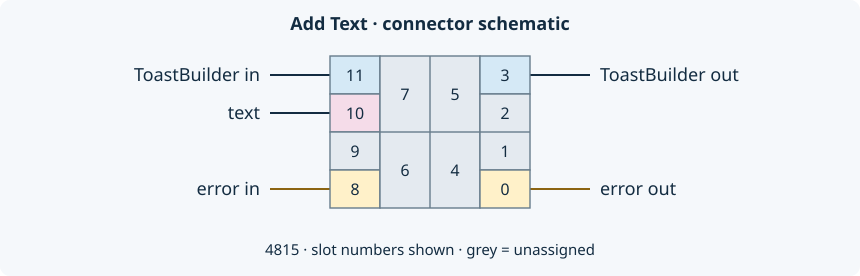

## Purpose and when to call

Add a displayed text block to an existing toast builder. Call it once for a title,
then again for a short description if needed. Each call appends a block; it does
not replace the previous text. The notification is displayed later by
[ToastService.Show](/reference/toastservice/show.md).

Displayed text, activation arguments and user input have different roles:

- Use **Add Text** for the message Windows displays.
- Use [Set Activation Arguments](/reference/toastbuilder/set-activation-arguments.md)
  for routing data returned when the notification body is activated.
- Use [Add Text Input](/reference/toastbuilder/add-text-input.md) for an editable
  field. Add a submitting button to receive its value in the activation payload.

## Connector and terminals



Pattern **4815**, twelve slots, five assigned terminals. The illustration keeps
their measured positions; unused slots are grey. Numbers are LabVIEW connector
slot indices. All five connections are saved as **Recommended**, not Required.
Nevertheless, wire the builder and error chain for the intended workflow.

### Inputs

| Terminal (slot) | LabVIEW type | Saved default | Meaning and precondition |
|---|---|---|---|
| `ToastBuilder in` (11) | `ToastBuilder.lvclass` | Default class value; no created native builder | Wire the output of Create or a preceding builder operation. A live native builder must exist. |
| `text` (10) | String | Empty string | Displayed text for this block. The wrapper performs no local empty-string validation. |
| `error in` (8) | Error cluster: Boolean status, I32 code, String source | No error: false, 0, empty source | On incoming error status, skip the operation and pass the class and error through. |

### Outputs

| Terminal (slot) | LabVIEW type | Meaning |
|---|---|---|
| `ToastBuilder out` (3) | `ToastBuilder.lvclass` | Builder after the call. It shares the same native handle as the input. This is not an independent builder or a new ownership token. |
| `error out` (0) | Error cluster | Propagated incoming error, or result of the property/native call chain. Inspect status, code and source. |

Output indicators have saved default values, but callers must use their returned
values rather than interpret those defaults as execution results.

## Behavior and errors

On the No Error branch, the VI reads the Builder Reference property, invokes
`Toast Native:Add Text.vi`, then writes the returned reference back to the class.
On the Error branch it passes the incoming class and error through unchanged.
It neither creates nor closes a builder, registers a handler, or displays a toast.

The wrapper does not parse `text` as activation arguments or XML. Pass ordinary
display text; inspect [Get XML](/reference/toastbuilder/get-xml.md) to see the
serialized result. Text layout and length constraints come from the underlying
toolkit and Windows. This VI exposes only the text parameter, not the toolkit's
optional styling or line-count arguments.

An uncreated or closed native handle can fail in the .NET call chain. Repeated
text additions can also exceed the toolkit's text capacity. The
[upstream AddText implementation](https://github.com/CommunityToolkit/WindowsCommunityToolkit/blob/da6d7d3f6ca9914dbe86d7d394e9a4abef25c9b6/Microsoft.Toolkit.Uwp.Notifications/Toasts/Builder/ToastContentBuilder.Visuals.cs)
counts reserved lines and can throw on overflow; do not infer unlimited blocks
from the String input. Native failures are returned through the standard error
cluster. This wrapper defines no additional custom error code and no rollback of
native mutations. After an error, check the result before continuing to Show.

## Minimal calling scenario

This sequence is a wiring guide, not an executable VI. Pass the builder and error
wire through each builder call; keep the service on its own class wire.

```text
ToastBuilder.Create
  -> Add Text (text = "Request #42")
  -> Add Text (text = "A short description")
  -> Get XML (optional inspection)
  -> ToastService.Show (builder input)
  -> wait for Stop / activation events
  -> ToastService.Close
  -> ToastBuilder.Close
```

Before Show, initialize ToastService with the chosen activation handler. Keep the
example's event loop running while it must receive activations. The builder can
then be passed to Show without exposing its .NET reference to the caller.

For an executable starting point, open **Toast With Reply.vi** in the project and
follow the [reply example](/guides/reply.md). Its first two Add Text calls supply
the title and question. Its text-input field and Send button are separate calls;
neither is created by Add Text.

### Ownership and cleanup

Create owns the native builder's lifetime. Copies of the LabVIEW class share its
handle, so branching the class wire does not create independent ownership.
Closing one alias invalidates the others. Keep one cleanup path: stop receiving
activations and close the service, then close the builder after its final use.
Run cleanup even if construction or Show failed; preserve the primary error.
Follow the [callback and ownership contract](/callbacks.md) for handler shutdown.
The current examples retain a final collection workaround; Close does not yet
guarantee that callbacks already in progress have drained. See that contract's
shutdown limitations before sharing references across asynchronous work.
Do not close the native reference inside Add Text or force a .NET collection here.

## Pitfalls and variants

- Do not read displayed text back from `Arguments` or `User Inputs`: configure
  those separately. A read-only label does not become a reply field.
- Do not treat an unwired class default as a created builder. Start with
  [Create](/reference/toastbuilder/create.md).
- Do not reuse an alias after [Close](/reference/toastbuilder/close.md).
- Keep the message concise. A long string can be clipped by Windows; repeated
  calls can fail because of the toolkit's reserved-line limits. Use Get XML and
  check errors before trying a different layout.
- Empty text and character encoding have no additional validation in this VI.
  This page does not claim every character/OS layout has been tested.

## Maturity and validation

**Documentation pilot; existing application method.** Connector slots, saved
defaults, terminal names and error-case wiring were reviewed against the saved
VI in LabVIEW 2026 Q3 (64-bit). No product VI was executed or changed for this
documentation task. Existing reply-example observations belong to its guide;
this review adds no new Windows runtime compatibility claim.

The template remains subject to review before expanding it to other methods
([#42](https://github.com/loicwoh/ToastNotifications/issues/42)). Automatic metadata
and diagram export remain a separate task
([#46](https://github.com/loicwoh/ToastNotifications/issues/46)).

## Related reading

- [ToastBuilder role and members](/api/toastbuilder.md)
- [Builder and service concepts](/concepts.md)
- [Receive a text reply](/guides/reply.md)
- [Native Add Text helper](/reference/toast-native/add-text.md)
- [Microsoft Toolkit AddText reference](https://learn.microsoft.com/en-us/dotnet/api/microsoft.toolkit.uwp.notifications.toastcontentbuilder.addtext?view=win-comm-toolkit-dotnet-7.1)
- [Microsoft API families and links](/microsoft.md)
