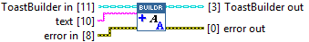
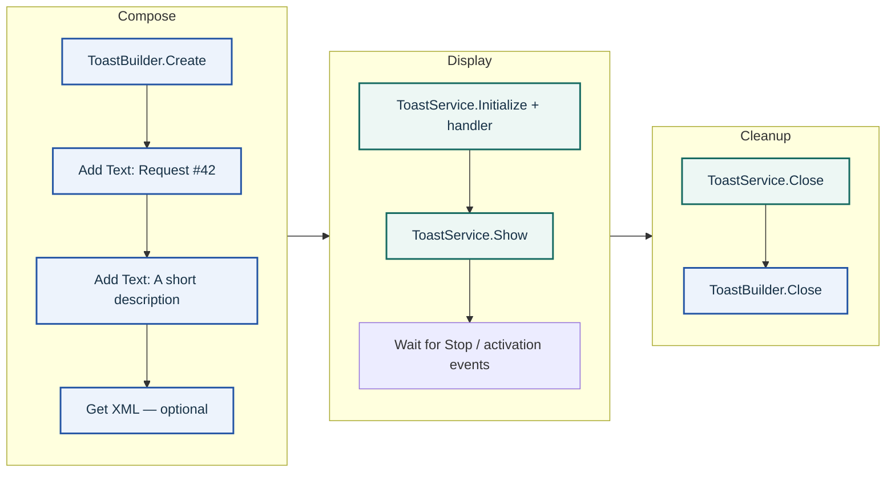

## Connector

## Inputs and outputs

| Input | Type | Default | Use |
|---|---|---|---|
| `ToastBuilder in` | ToastBuilder | Uninitialized class value | A live builder returned by Create or a previous composition call. |
| `text` | String | Empty | Displayed text to append. |
| `error in` | Error cluster | No error | Standard error chain. |

| Output | Type | Use |
|---|---|---|
| `ToastBuilder out` | ToastBuilder | The same native builder after the call; not an independent copy. |
| `error out` | Error cluster | Incoming error or failure from the native call chain. |

## Typical call sequence

Wire the builder and error chain through composition calls; keep the service on
its own class wire. See [Toast With Reply.vi](/guides/reply.md) for a runnable example.

## Usage notes

- Each call appends displayed text. For an editable field, use
  [Add Text Input](/reference/toastbuilder/add-text-input.md); for routing data, use
  [Set Activation Arguments](/reference/toastbuilder/set-activation-arguments.md).
- No local empty-string validation is performed. Layout and text capacity are
  governed by the [underlying toolkit](https://learn.microsoft.com/en-us/dotnet/api/microsoft.toolkit.uwp.notifications.toastcontentbuilder.addtext?view=win-comm-toolkit-dotnet-7.1).
  Native errors propagate through `error out`; native mutations are not rolled back.
- Class copies share the native handle. Close the builder once after its last use,
  including on failure. Closing an alias invalidates the others. For asynchronous
  shutdown and its current limitations, see the [ownership contract](/callbacks.md).

## Related reading

- [ToastBuilder](/api/toastbuilder.md) · [Builder and service concepts](/concepts.md)
- [Create](/reference/toastbuilder/create-toastbuilder.md) · [Get XML](/reference/toastbuilder/get-xml.md) · [Close](/reference/toastbuilder/close.md)
- [Receive a text reply](/guides/reply.md) · [ToastService](/api/toastservice.md)
- [Microsoft API reference directory](/microsoft.md)
