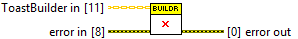
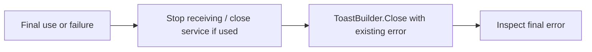

## Connector

## Inputs and outputs

| Input | Type | Default | Use |
|---|---|---|---|
| `ToastBuilder in` | ToastBuilder | Uninitialized | The builder whose native handle is to be released. |
| `error in` | Error cluster | No error | Primary error to preserve while attempting cleanup. |

| Output | Type | Use |
|---|---|---|
| `error out` | Error cluster | Incoming error merged before a cleanup failure. |

## Typical call sequence

Place cleanup on a path reached after both success and failure. Do not put this
call inside a No Error-only case that prevents cleanup when an earlier call fails.

## Usage notes

- Close has **no builder output**. Treat the input and all its aliases as finished
  after closing their shared native handle. This method does not clear the stored
  handle in other copies of the class.
- The release helper ignores empty or already closed handles. Prefer one owner
  and one cleanup path; this does not establish safe concurrent use and closure.
- The incoming error does not suppress release. If both an incoming error and a
  cleanup error exist, the primary incoming error takes precedence in the merge.
- Close does not unregister service callbacks, call Dispose or collect the .NET
  heap. Keep service/handler shutdown separate; see the [current contract](/callbacks.md).

## Related reading

[ToastBuilder](/api/toastbuilder.md) · [Create](/reference/toastbuilder/create.md) ·
[ToastService.Close](/reference/toastservice/close.md) · [Coverage and limits](/coverage.md)
