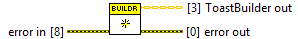
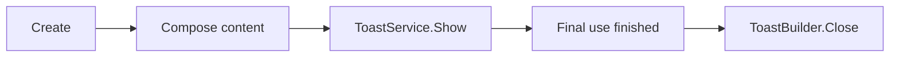

## Connector

## Inputs and outputs

| Input | Type | Default | Use |
|---|---|---|---|
| `error in` | Error cluster | No error | Incoming error chain. |

| Output | Type | Use |
|---|---|---|
| `ToastBuilder out` | ToastBuilder | Owns a new native builder on success; uninitialized when skipped on incoming error. |
| `error out` | Error cluster | Creation result or propagated incoming error. |

## Typical call sequence

For callback setup and service shutdown, follow the [reply example](/guides/reply.md).

## Usage notes

- There is no builder input. This creates a new instance; it does not reinitialize
  or release a previously created builder. Close the previous owner before discarding it.
- A default class constant has no created native builder. Use this output before
  calling composition methods. Check `error out` before displaying a notification.
- Copies share the same native handle. Keep one owner responsible for
  [Close](/reference/toastbuilder/close.md), including after a later failure.
  Creating independent notifications requires independent Create calls.

## Related reading

[ToastBuilder](/api/toastbuilder.md) · [Add Text](/reference/toastbuilder/add-text.md) ·
[Ownership](/callbacks.md) · [Examples](/examples.md)
