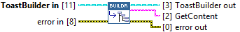
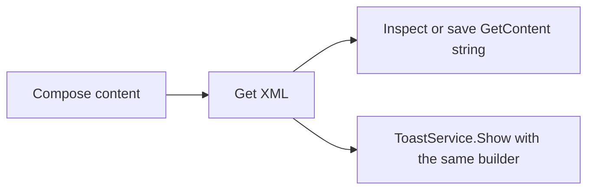

## Connector

## Inputs and outputs

| Input | Type | Default | Use |
|---|---|---|---|
| `ToastBuilder in` | ToastBuilder | Uninitialized | A created builder containing the current toast configuration. |
| `error in` | Error cluster | No error | Incoming error chain. |

| Output | Type | Use |
|---|---|---|
| `ToastBuilder out` | ToastBuilder | The same native builder; the content can still be composed or displayed. |
| `GetContent` | String | Serialized toast XML copied into LabVIEW. |
| `error out` | Error cluster | Serialization/cleanup result or propagated incoming error. |

## Typical call sequence

The [reply example](/guides/reply.md) displays the generated XML on its front panel.

## Usage notes

- This is the ToastBuilder override of the XML export operation on
  [ToastSource](/api/toastsource.md). Calls through the base type select this
  implementation for a ToastBuilder instance.

- `GetContent` is the saved output name. It contains XML text, not a .NET handle.
  There is no reference to close for this String output.
- The method does not display a notification. It acquires a temporary content
  reference internally and closes it after serialization; the builder stays alive.
- Get XML is skipped on incoming error. Check `error out` before using the string.
  The call does not provide a general XML schema or Windows-rendering validator.
- The application can save this string with ordinary file I/O. Pass the saved XML text to
  [Create ToastFromXML](/reference/toastfromxml/create-toastfromxml.md) to display it later.
  Keep one [Close](/reference/toastbuilder/close.md) after the builder's final use.

## Related reading

[ToastBuilder](/api/toastbuilder.md) · [Show](/reference/toastbuilder/show.md) ·
[Builder concepts](/concepts.md?id=builder) · [Current coverage](/coverage.md)
