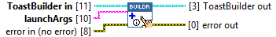
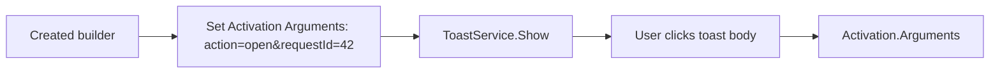

## Connector

## Inputs and outputs

| Input | Type | Default | Use |
|---|---|---|---|
| `ToastBuilder in` | ToastBuilder | Uninitialized | A created, live builder. |
| `launchArgs` | String | Empty | Raw body-click arguments, for example `action=open&requestId=42`. |
| `error in (no error)` | Error cluster | No error | Incoming error chain. |

| Output | Type | Use |
|---|---|---|
| `ToastBuilder out` | ToastBuilder | Aliases the input builder with the body activation configured on success. |
| `error out` | Error cluster | Native result or propagated incoming error. |

## Typical call sequence

See [multiple actions](/guides/multiple-actions.md) for the event loop and the
distinction between body and button activations.

## Usage notes

- Each successful call replaces the previous body launch string. It does not
  append a parameter or encode a key/value structure. Parse the returned string
  according to the application's own convention.
- This method selects Foreground activation. Individual button arguments are
  configured by [Add Bouton](/reference/toastbuilder/add-bouton.md); URI actions
  use [Add Link Button](/reference/toastbuilder/add-link-button.md).
- Arguments and submitted `User Inputs` are distinct. Clicking the body should
  not be treated as the same action as submitting a text field with its button.
- The builder remains owned by the caller. No independent builder is created;
  close once after the final use of all aliases.

## Related reading

[ToastBuilder](/api/toastbuilder.md) · [Add Text Input](/reference/toastbuilder/add-text-input.md) ·
[Activation concepts](/concepts.md?id=activation) · [Multiple actions](/guides/multiple-actions.md)
