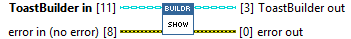
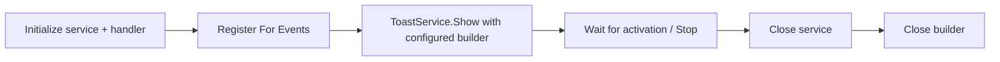

## Connector

## Inputs and outputs

| Input | Type | Default | Use |
|---|---|---|---|
| `ToastBuilder in` | ToastBuilder | Uninitialized | A created, configured builder to display. |
| `error in (no error)` | Error cluster | No error | Incoming error chain. |

| Output | Type | Use |
|---|---|---|
| `ToastBuilder out` | ToastBuilder | Aliases the input builder; Show does not close it. |
| `error out` | Error cluster | Native display-call result or propagated incoming error. |

## Typical call sequence

Prefer [ToastService.Show](/reference/toastservice/show.md) in application code;
it delegates display to this builder method. The [reply example](/guides/reply.md)
shows that complete workflow.

## Usage notes

- This is the ToastBuilder override of the display operation on
  [ToastSource](/api/toastsource.md). Calls through the base type select this
  implementation for a ToastBuilder instance.

- Calling this method can display a real Windows notification. It does not
  initialize a service, register the callback or create an activation handler.
- If activations must reach LabVIEW, set up the service and registration before
  display and retain the receiving loop. `error out` reports this call's result,
  not a later user reply or callback-conversion result.
- Calling Show does not transfer ownership. Keep the builder alive until its
  last use, then [Close](/reference/toastbuilder/close.md) it once.
- Callback shutdown is separate from builder cleanup; follow the
  [ownership contract and its current limitations](/callbacks.md).

## Related reading

[ToastBuilder](/api/toastbuilder.md) · [ToastService](/api/toastservice.md) ·
[Get XML](/reference/toastbuilder/get-xml.md) · [Examples](/examples.md)
