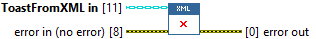
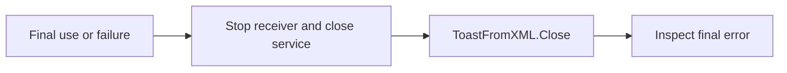

## Connector

## Inputs and outputs

| Input | Type | Default | Use |
|---|---|---|---|
| `ToastFromXML in` | ToastFromXML | Uninitialized | Source whose document is to be released. |
| `error in` | Error cluster | No error | Primary error to preserve while attempting cleanup. |

| Output | Type | Use |
|---|---|---|
| `error out` | Error cluster | Incoming error merged before a reference-release error. |

## Typical call sequence

## Usage notes

- Overrides ToastSource.Close and releases the stored XML Document reference.
  Do not place it inside a No Error-only cleanup path.
- Has no source output. Treat the input and all copied aliases as finished after
  Close. It does not clear the reference stored in other class copies.
- Does not dismiss an already displayed notification, unregister callbacks or
  close the service. It does not force .NET garbage collection.
- Normal closure does not repair the constructor's incomplete partial-failure
  cleanup path; see [known limits](/coverage.md).

## Related reading

[ToastFromXML](/api/toastfromxml.md) · [Create ToastFromXML](/reference/toastfromxml/create-toastfromxml.md) ·
[ToastService.Close](/reference/toastservice/close.md)
