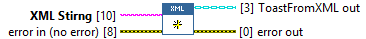
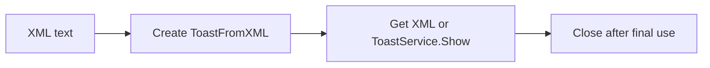

## Connector

## Inputs and outputs

| Input | Type | Default | Use |
|---|---|---|---|
| `XML Stirng` | String | Empty | **Required.** XML text to parse; the saved terminal name currently contains this spelling. |
| `error in` | Error cluster | No error | Incoming error chain. |

| Output | Type | Use |
|---|---|---|
| `ToastFromXML out` | ToastFromXML | Source owning the parsed document after successful creation. |
| `error out` | Error cluster | Creation, parsing or property-assignment result. |

## Typical call sequence

## Usage notes

- Select this instance through Create ToastSource (Poly), or call it directly.
  The output retains the concrete ToastFromXML type.
- Stores a WinRT XML Document, rather than the original string. Class copies
  share that reference. The application owns Close.
- Parsing does not validate the complete toast schema or guarantee rendering.
  Service initialization and callback registration remain separate operations.
- No file is opened. Load a file as text in the application before this call.
- Partial-failure cleanup is incomplete: if Load XML fails after document
  creation, the new document is not guaranteed to be released or recoverable
  through the returned class. See [known limits](/coverage.md).

## Related reading

[ToastFromXML](/api/toastfromxml.md) · [XML example](/guides/xml.md) ·
[Close](/reference/toastfromxml/close.md)
