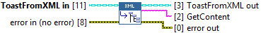
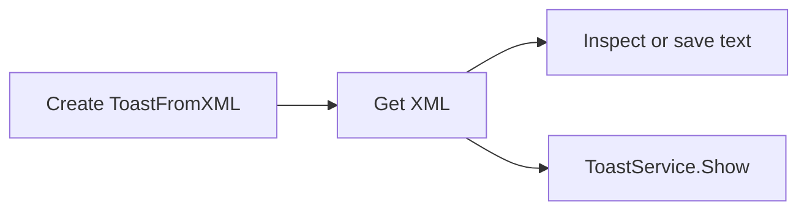

## Connector

## Inputs and outputs

| Input | Type | Default | Use |
|---|---|---|---|
| `ToastFromXML in` | ToastFromXML | Uninitialized | Created source with a live XML Document. |
| `error in` | Error cluster | No error | Incoming error chain. |

| Output | Type | Use |
|---|---|---|
| `ToastFromXML out` | ToastFromXML | Same source; document remains alive. |
| `GetContent` | String | Serialized document XML; empty on the incoming-error path. |
| `error out` | Error cluster | Serialization/conversion/cleanup result or incoming error. |

## Typical call sequence

## Usage notes

- Overrides ToastSource.Get XML. Calls the document's GetXml method and releases
  the temporary boxed string after copying its value into LabVIEW.
- DOM serialization can normalize whitespace, declarations and attribute format;
  it is not a byte-for-byte copy of the constructor input.
- Does not display or close the source. No native reference is returned to the
  application. Check error out before using GetContent.

## Related reading

[ToastFromXML](/api/toastfromxml.md) · [XML example](/guides/xml.md) ·
[Show](/reference/toastfromxml/show.md)
