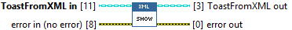
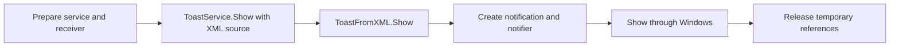

## Connector

## Inputs and outputs

| Input | Type | Default | Use |
|---|---|---|---|
| `ToastFromXML in` | ToastFromXML | Uninitialized | Created source with a live XML Document. |
| `error in` | Error cluster | No error | Incoming error chain. |

| Output | Type | Use |
|---|---|---|
| `ToastFromXML out` | ToastFromXML | Same source with document retained. |
| `error out` | Error cluster | Display/temporary cleanup result or incoming error. |

## Typical call sequence

## Usage notes

- Use ToastService.Show in the application. It dynamically invokes this source
  override and borrows the source without closing it.
- Keeps the stored document alive. The caller closes the source after its last
  use. This method attempts to release the notification and notifier even after
  a display error.
- Callback registration and the receiving event loop are separate. Showing a
  notification does not guarantee it is visible under the current Windows settings.
- No XML loading or content composition occurs here.

## Related reading

[ToastService.Show](/reference/toastservice/show.md) ·
[XML example](/guides/xml.md) · [Close](/reference/toastfromxml/close.md)
