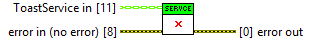
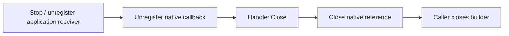

## Connector

## Inputs and outputs

| Input | Type | Default | Use |
|---|---|---|---|
| `ToastService in` | ToastService | Uninitialized | Service containing the native subscription and initialized handler to close. |
| `error in (no error)` | Error cluster | No error | Primary error preserved while cleanup is attempted. |

| Output | Type | Use |
|---|---|---|
| `error out` | Error cluster | Incoming error merged first, then native unregistration/reference cleanup and handler cleanup errors. |

## Typical call sequence

## Usage notes

- Wire Close on a path reached after success **and** failure. Its cleanup branches
  start without the incoming error; that error is merged back at the end.
  It has **no service output** and does not clear references in existing class
  aliases. Finish using the service and its borrowed handler resources first.
- The shutdown order is to unsubscribe the native callback before destroying
  handler resources, then release the native reference. Unsubscription alone
  does not prove that callbacks already in flight have finished; coordinate
  receiver shutdown and avoid concurrent service operations.
- Preserve the primary error while attempting cleanup and inspect the final
  error. An error result must not be treated as proof that every resource was
  released.
- Stop and unregister the application's receiving Event Structure registration
  before this call. For the supplied plugin, handler Close destroys the owned
  User Event; the application must not destroy that borrowed event separately.
- Close does not close a borrowed builder. Close it separately after service
  shutdown. A custom handler is responsible for resources acquired by its hooks;
  unrelated caller-owned events or queues are outside the service's cleanup.
- Call once, outside the callback. There is no repeated-close or empty-service
  guard here. Partial setup and concurrent shutdown are
  [known limits](/callbacks.md?id=shutdown-is-still-being-hardened), tracked in
  [issue #16](https://github.com/loicwoh/ToastNotifications/issues/16).
- Close does not call the .NET garbage collector. The examples retain a final
  collection workaround for an observed callback reservation; it does not
  replace unregistration or establish that active callbacks have drained.

## Related reading

[ToastService](/api/toastservice.md) · [Initialize](/reference/toastservice/initialize.md) ·
[ToastBuilder.Close](/reference/toastbuilder/close.md) ·
[Callbacks and ownership](/callbacks.md)
