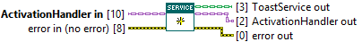
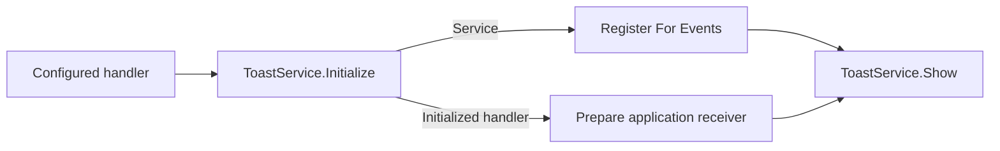

## Connector

## Inputs and outputs

| Input | Type | Default | Use |
|---|---|---|---|
| `ActivationHandler in` | ActivationHandler | Base handler | **Required.** Supply the child class that will process activations. |
| `error in (no error)` | Error cluster | No error | Incoming error chain. |

| Output | Type | Use |
|---|---|---|
| `ToastService out` | ToastService | Service carrying the resources acquired so far. Wire this output to Close even when initialization fails. |
| `ActivationHandler out` | ActivationHandler | Value returned by the handler Initialize hook; retains its runtime child type. |
| `error out` | Error cluster | Native initialization, handler initialization or storage error; incoming error otherwise. |

## Typical call sequence

For the User Event plugin, cast the returned handler to
[UserEventActivationHandler](/api/usereventactivationhandler.md), read Event Ref
and register the application's Event Structure before showing the toast.

## Usage notes

- This VI requires `ActivationHandler in`, calls its Initialize hook and
  stores/returns the initialized value. Callback registration remains a
  separate step.
- Native initialization calls `WasCurrentProcessToastActivated`. Its Boolean
  result is not exposed; it is not an activation payload or a waiting operation.
- The input handler's runtime child class selects the Initialize override and,
  later, Handle Activation. The base handler owns no delivery mechanism.
  Configure a child before this call; do not separately initialize the same
  owned handler lifecycle a second time.
- On incoming error, native and handler initialization are skipped:
  `ToastService out` is a default service and `ActivationHandler out` is the
  unchanged input handler. Check `error out` before using either output.
- Use the initialized output, or [Read ActivationHandler](/reference/toastservice/read-activationhandler.md),
  to obtain references created by the hook. The original class value does not
  gain fields written into a later value.
- If initialization fails after it starts, the VI attempts to store the native
  reference and the handler returned by the hook. Initialization errors take
  precedence over storage errors. Pass the returned service and error to
  [Close](/reference/toastservice/close.md). Keep the returned service wire
  through the error path and use the same cleanup path for success and failure,
  as shown in [Toast With Reply.vi](/guides/reply.md).
- A custom Initialize hook must return any resources it acquired before
  reporting an error so its Close hook can release them.

## Related reading

[ToastService](/api/toastservice.md) · [Register For Events](/reference/toastservice/register-for-events.md) ·
[Callbacks and ownership](/callbacks.md) · [Handle multiple actions](/guides/multiple-actions.md)
