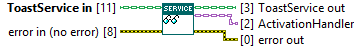
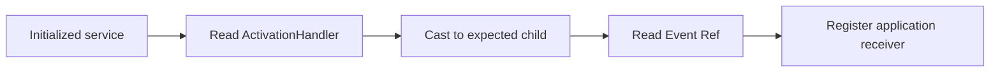

## Connector

## Inputs and outputs

| Input | Type | Default | Use |
|---|---|---|---|
| `ToastService in` | ToastService | Uninitialized | **Required.** Service returned by successful Initialize. |
| `error in (no error)` | Error cluster | No error | Incoming error chain. |

| Output | Type | Use |
|---|---|---|
| `ToastService out` | ToastService | Unchanged service value. |
| `ActivationHandler` | ActivationHandler | Stored handler value, retaining its runtime child type; default base value on incoming error. |
| `error out` | Error cluster | Unchanged incoming error/warning. |

## Typical call sequence

## Usage notes

- Prefer the class property node `ActivationHandler` when reading this native
  data-member accessor. It returns the value stored by Initialize, including
  references created by the handler's Initialize hook. Initialize also returns
  that initialized handler directly.
- The output's static type is ActivationHandler. Use a checked downcast to the
  expected plugin before accessing its child-specific properties; reading the
  base class does not create a User Event.
- This read neither initializes nor transfers ownership of a handler resource.
  Borrow Event Ref for the receiving loop; ToastService.Close invokes the
  handler Close hook. The application owns its separate Event Registration Ref.
- Copies of the handler value can alias the same event or queue handle. Closing
  the service can invalidate those borrowed references. Do not destroy them
  independently or retain them for use after Close.
- On incoming error, no member read occurs and the handler output is the default
  base value. Do not treat that output as a recovered initialized child.

## Related reading

[ToastService](/api/toastservice.md) · [Initialize](/reference/toastservice/initialize.md) ·
[ActivationHandler](/api/activationhandler.md) · [User Event plugin](/api/usereventactivationhandler.md) ·
[Callbacks and ownership](/callbacks.md)
