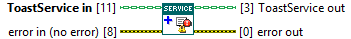
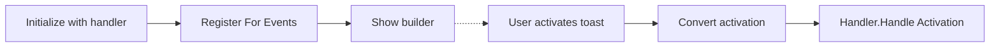

## Connector

## Inputs and outputs

| Input | Type | Default | Use |
|---|---|---|---|
| `ToastService in` | ToastService | Uninitialized | **Required.** Service returned by a successful Initialize. |
| `error in (no error)` | Error cluster | No error | Incoming error chain. |

| Output | Type | Use |
|---|---|---|
| `ToastService out` | ToastService | Carries the new registration on success. Preserves the existing registration on a duplicate call and passes the service through on incoming error. |
| `error out` | Error cluster | Reports error 550016 if a callback is already registered. Otherwise reports setup errors or passes through the incoming error. |

## Typical call sequence

## Usage notes

- The handler comes from the service; this method has no handler input. The
  stored runtime class selects the dynamic Handle Activation implementation.
  Native event data is converted to LabVIEW values before that call.
- This registration connects the .NET `OnActivated` event to the toolkit
  callback. It does **not** register a LabVIEW Event Structure for the plugin's
  User Event. Prepare that separate application-owned receiver before Show.
- Call once per service lifecycle. A second call returns error 550016 and
  preserves the first registration so Close can unregister it. Close the
  service and call Initialize again to start a new lifecycle.
- Continue with `ToastService out`, which carries the registration. A class
  copy taken before registration does not acquire its newly stored handle.
  Existing copies of a handle still share its lifetime.
- Errors from this VI concern setup, not future callback delivery. The example's
  activation error is delivered separately; see [error observations](/callbacks.md?id=errors-are-two-separate-observations).
- Close owns unregistration. Keep callback work short and do not close the
  service from inside its callback. Partial initialization and shutdown races
  remain [lifetime limits](/callbacks.md?id=shutdown-is-still-being-hardened).

## Related reading

[ToastService](/api/toastservice.md) · [Initialize](/reference/toastservice/initialize.md) ·
[Show](/reference/toastservice/show.md) · [Close](/reference/toastservice/close.md) ·
[User Event plugin](/api/usereventactivationhandler.md)
