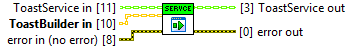
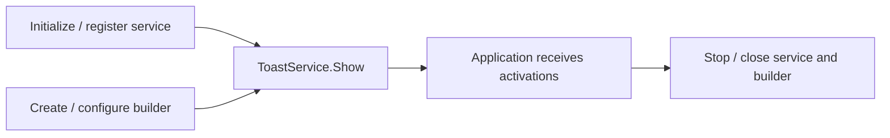

## Connector

## Inputs and outputs

| Input | Type | Default | Use |
|---|---|---|---|
| `ToastService in` | ToastService | Uninitialized | Service from the setup chain, with callback registration if activations are needed. |
| `ToastBuilder in` | ToastBuilder | Uninitialized | **Required.** Created, configured builder whose native handle is still live. |
| `error in (no error)` | Error cluster | No error | Incoming error chain. |

| Output | Type | Use |
|---|---|---|
| `ToastService out` | ToastService | Same service value; no new service resource is acquired. |
| `error out` | Error cluster | Builder display result, or unchanged incoming error. |

## Typical call sequence

## Usage notes

- This method delegates to [ToastBuilder.Show](/reference/toastbuilder/show.md).
  It does not inspect or validate service state, initialize the service or
  register a callback. Successful display alone does not prove reply delivery
  is configured.
- Show borrows the builder and has **no builder output**. Keep its existing
  class value for caller-owned cleanup; the service does not retain an
  independent copy of its native resource or close it.
- On incoming error, the builder Show call is skipped and the service/error
  pass through unchanged.
- `error out` reports the display call, not the user's later action or input.
  Those arrive asynchronously through the handler. Keep the receiving workflow
  alive after this VI returns.
- Use application actions for callback replies and protocol buttons for opening
  links. Clicking a protocol button does not invoke the app handler for that
  button; see [Open a link](/guides/protocol.md).

## Related reading

[ToastService](/api/toastservice.md) · [Register For Events](/reference/toastservice/register-for-events.md) ·
[ToastBuilder](/api/toastbuilder.md) · [Receive a text reply](/guides/reply.md) ·
[Close](/reference/toastservice/close.md)
