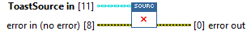
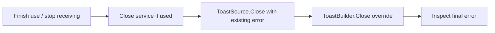

## Connector

## Inputs and outputs

| Input | Type | Default | Use |
|---|---|---|---|
| `ToastSource in` | ToastSource | Default base class | Dynamic dispatch input: caller-owned source to close. |
| `error in (no error)` | Error cluster | No error | Primary error to preserve during cleanup. |

| Output | Type | Use |
|---|---|---|
| `error out` | Error cluster | Incoming error for the base method; merged cleanup result for an implementation. |

## Typical call sequence

## Usage notes

- The **base implementation performs no cleanup** because it owns no resource.
  With or without incoming error, it only propagates the error.
- Concrete overrides must attempt cleanup **even on incoming error**. Preserve
  that primary error before cleanup failures; do not suppress release with a
  No Error-only case. See [ToastBuilder.Close](/reference/toastbuilder/close.md).
- Close has no source output. Treat released native resources and their aliases
  as finished. Source copies do not acquire independent resource ownership.
- ToastService borrows the source for Show. Its own Close does not call this
  source Close; the caller must do so separately.
- Safe concurrent closure, callback draining and repeated-use guarantees remain
  subject to the [current lifetime limits](/callbacks.md).

## Related reading

[ToastSource](/api/toastsource.md) · [ToastBuilder.Close](/reference/toastbuilder/close.md) ·
[ToastService.Close](/reference/toastservice/close.md) · [Ownership](/callbacks.md)
