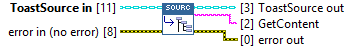
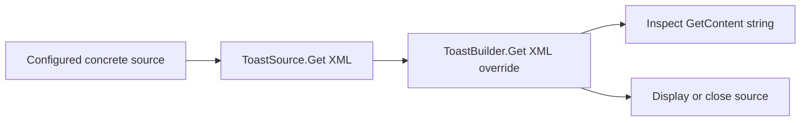

## Connector

## Inputs and outputs

| Input | Type | Default | Use |
|---|---|---|---|
| `ToastSource in` | ToastSource | Default base class | Dynamic dispatch input: source to serialize. |
| `error in (no error)` | Error cluster | No error | Incoming error chain. |

| Output | Type | Use |
|---|---|---|
| `ToastSource out` | ToastSource | Source returned by the implementation; remains owned by the caller. |
| `GetContent` | String | Toast XML from the concrete implementation; empty for the base method. |
| `error out` | Error cluster | Export result or incoming error. |

## Typical call sequence

## Usage notes

- The **base implementation returns an empty string** and propagates source/error.
  It does not serialize content or report an unsupported operation.
- Override the exact method name `Get XML.vi`, preserving connector positions and
  the String output. `GetXML.vi` would be a different method, not this override.
- The output is copied LabVIEW text: there is no .NET reference for the caller to close.
- Export does not display the toast or load XML back into a source. ToastFromXML
  and file-template support remain [planned](/coverage.md).

## Related reading

[ToastSource](/api/toastsource.md) · [ToastBuilder.Get XML](/reference/toastbuilder/get-xml.md) ·
[Show](/reference/toastsource/show.md) · [Close](/reference/toastsource/close.md)
