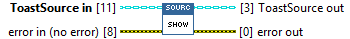
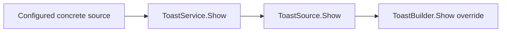

## Connector

## Inputs and outputs

| Input | Type | Default | Use |
|---|---|---|---|
| `ToastSource in` | ToastSource | Default base class | Dynamic dispatch input: use a created concrete source. |
| `error in (no error)` | Error cluster | No error | Incoming error chain. |

| Output | Type | Use |
|---|---|---|
| `ToastSource out` | ToastSource | Source returned by the concrete implementation; ownership remains with the caller. |
| `error out` | Error cluster | Display-call result or incoming error. |

## Typical call sequence

## Usage notes

- Prefer [ToastService.Show](/reference/toastservice/show.md) in application code.
  It invokes this method dynamically, without knowing how the source was built.
- The **base implementation does nothing**, passes the source/error through and
  does not report a missing native resource. A bare ToastSource is not a displayable toast.
- Override Show to display concrete content. Skip work on incoming error and
  return the source without closing or transferring its resources.
- The method reports the display call, not a later activation. Service setup,
  callback registration and receiving-loop lifetime are separate requirements.

## Related reading

[ToastSource](/api/toastsource.md) · [ToastBuilder.Show](/reference/toastbuilder/show.md) ·
[ToastService.Show](/reference/toastservice/show.md) · [Ownership](/callbacks.md)
