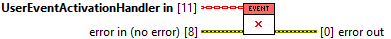
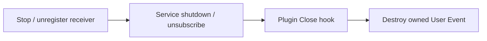

## Connector

## Inputs and outputs

| Input | Type | Default | Use |
|---|---|---|---|
| `UserEventActivationHandler in` | UserEventActivationHandler | No live event | Initialized child whose owned User Event is to be destroyed. |
| `error in (no error)` | Error cluster | No error | Primary error to preserve while attempting cleanup. |

| Output | Type | Use |
|---|---|---|
| `error out` | Error cluster | Incoming error merged first, then event-reference access/destruction error. |

## Typical call sequence

## Usage notes

- Let [ToastService.Close](/reference/toastservice/close.md) invoke this override.
  Do not independently destroy its borrowed Event Ref or invoke Close twice
  through separate aliases of the same handler.
- Incoming error does not gate the reference read or cleanup attempt. The
  incoming error is merged first with the destruction result. The event read's
  own error is wired to Destroy User Event; always inspect final `error out`.
- The application owns the Event Registration Ref created for its receiving
  Event Structure. Stop/unregister that registration before destroying the
  handler-owned User Event. They are different references with different owners.
- There is **no handler output**, no reference clearing in existing class copies
  and no explicit empty-reference or repeated-close guard. Copies of Event Ref
  become invalid after successful destruction.
- Coordinate callback completion before destruction. This hook supplies no
  drain mechanism and does not unregister the native .NET callback itself.
  The documented service shutdown order remains subject to the
  [lifetime work in #16](https://github.com/loicwoh/ToastNotifications/issues/16).
- Destroy User Event is explicit resource cleanup; garbage collection does not
  replace it. Builder and service native references have their separate owners.

## Related reading

[User Event plugin](/api/usereventactivationhandler.md) · [Initialize](/reference/usereventactivationhandler/initialize.md) ·
[Read Event Ref](/reference/usereventactivationhandler/read-event-ref.md) · [Ownership](/callbacks.md)
