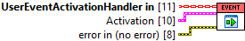
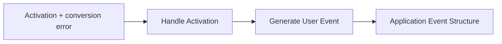

## Connector

## Inputs and outputs

| Input | Type | Default | Use |
|---|---|---|---|
| `UserEventActivationHandler in` | UserEventActivationHandler | No live event | Dynamic-dispatch child holding the event created by Initialize. |
| `Activation` | Activation cluster | Empty Arguments and User Inputs | Converted activation values to forward. |
| `error in (no error)` | Error cluster | No error | Conversion error to forward as data, without suppressing delivery. |

**No connector outputs.** This override attempts User Event delivery. Its saved
short description is inherited text about the base extension point; unlike the
empty base method, this implementation generates an event.

| Activation Event Data field | Type | Meaning |
|---|---|---|
| `Activation` | Activation cluster | Raw Arguments and submitted User Inputs Key/Value pairs. |
| `error` | Error cluster | Conversion result supplied to this invocation, not the event-generation result. |

## Typical call sequence

## Usage notes

- **Incoming error is payload, not an execution gate.** The override packages
  Activation and the incoming error together and attempts generation without
  feeding that error into Generate User Event's error input. The receiver can
  therefore observe a conversion failure instead of silently losing the reply.
- The callback invokes this method with the initialized handler captured during
  service registration. Normally the application receives its event rather than
  calling this override directly.
- The delivery path needs a live initialized event and an application receiver
  registered before Show. This method does not create an event or register a loop.
- Neither the Event Ref read error nor Generate User Event's error output is
  exposed here. An invalid event or failed delivery cannot be inferred from the
  payload's conversion error; diagnostics remain in
  [issue #22](https://github.com/loicwoh/ToastNotifications/issues/22).
- The payload contains LabVIEW values, with no native activation handles to
  close in the receiving loop. Its `error` field is the current invocation's
  conversion result, not the final service error or an event history.
- Keep response processing in the application's loop. This method does not
  wait for that processing to finish or send an acknowledgement to the callback.

## Related reading

[User Event plugin](/api/usereventactivationhandler.md) · [Base extension point](/reference/activationhandler/handle-activation.md) ·
[Read Event Ref](/reference/usereventactivationhandler/read-event-ref.md) ·
[Error observations](/callbacks.md?id=errors-are-two-separate-observations) · [Reply example](/guides/reply.md)
