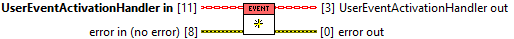
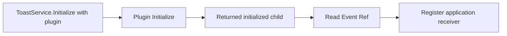

> **Lifecycle hook:** ToastService.Initialize invokes this override to create the
> event. Supply the plugin to the service instead of calling this hook yourself.
> [See the lifecycle sequence](/api/activationhandler.md?id=hooks-orchestrated-by-toastservice).

## Connector

## Inputs and outputs

| Input | Type | Default | Use |
|---|---|---|---|
| `UserEventActivationHandler in` | UserEventActivationHandler | No live event | Dynamic child value passed through ToastService.Initialize. |
| `error in (no error)` | Error cluster | No error | Incoming setup error chain. |

| Output | Type | Use |
|---|---|---|
| `UserEventActivationHandler out` | UserEventActivationHandler | Value storing the newly created event on success; unchanged on incoming error. |
| `error out` | Error cluster | Event creation/storage error, or incoming error. |

## Typical call sequence

## Usage notes

- Normally call [ToastService.Initialize](/reference/toastservice/initialize.md),
  not this override separately. Cast its returned ActivationHandler value to
  this child before reading Event Ref. You can also read the stored handler
  through [ToastService.ActivationHandler](/reference/toastservice/read-activationhandler.md).
- The created event is typed with Activation Event Data: `Activation` plus its
  conversion `error`. The handler owns the User Event; the application owns
  its separate receiving Event Registration Ref.
- Prepare the receiver and call the service's Register For Events before Show.
  Event creation by itself does not connect the native activation callback.
- Incoming error skips event creation and preserves the input handler. A
  successful read of an uninitialized class does not make its event live.
- Initialize once per owned lifecycle. Repeated calls can overwrite a live
  event reference without destroying it. A storage failure after creation has
  no rollback path here; partial initialization remains in
  [issue #16](https://github.com/loicwoh/ToastNotifications/issues/16).

## Related reading

[User Event plugin](/api/usereventactivationhandler.md) · [Read Event Ref](/reference/usereventactivationhandler/read-event-ref.md) ·
[Handle multiple actions](/guides/multiple-actions.md) · [Close](/reference/usereventactivationhandler/close.md)
