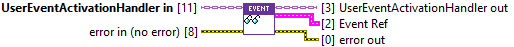
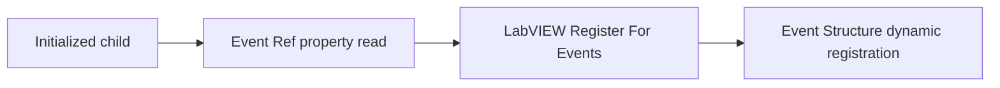

## Connector

## Inputs and outputs

| Input | Type | Default | Use |
|---|---|---|---|
| `UserEventActivationHandler in` | UserEventActivationHandler | No live event | **Required.** Initialized child returned by the service. |
| `error in (no error)` | Error cluster | No error | Incoming error chain. |

| Output | Type | Use |
|---|---|---|
| `UserEventActivationHandler out` | UserEventActivationHandler | Unchanged handler value. |
| `Event Ref` | User Event refnum of Activation Event Data | Borrowed stored event; invalid/default refnum on incoming error. |
| `error out` | Error cluster | Unchanged incoming error/warning. |

## Typical call sequence

## Usage notes

- Use a read-only class property node `Event Ref`. The property exposes a
  **User Event**, not an Event Registration Ref: the application chooses how
  to register it alongside its other events.
- Read from the initialized handler, not the original class constant supplied
  before service initialization. Reading this property creates no event and
  does not validate that the stored reference is still live.
- The Event Structure receives `Activation` and conversion `error` as payload.
  Match submitted values by `Activation.User Inputs.Key`; the raw activation
  string remains under `Activation.Arguments`.
- Borrow the event. Do not destroy it independently; handler Close does that.
  Stop and unregister the application's receiving registration before service
  Close, then stop using all borrowed copies of Event Ref.
- This read skips its member access on incoming error and returns an invalid
  event refnum. Check the setup error before registering the receiver.

## Related reading

[User Event plugin](/api/usereventactivationhandler.md) · [Initialize](/reference/usereventactivationhandler/initialize.md) ·
[User Event flow](/callbacks.md?id=user-event-flow) · [Receive a text reply](/guides/reply.md)
