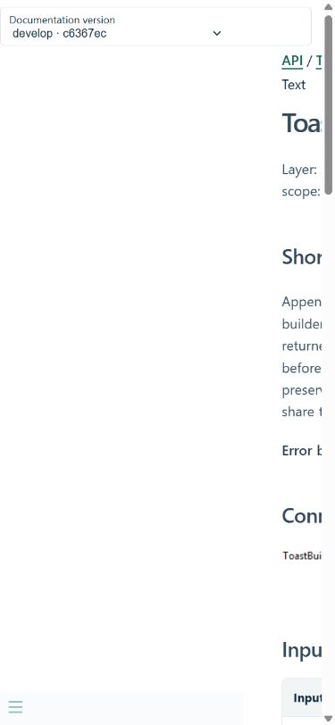
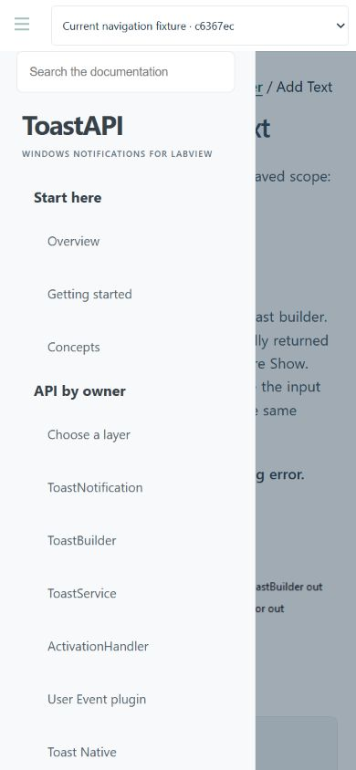
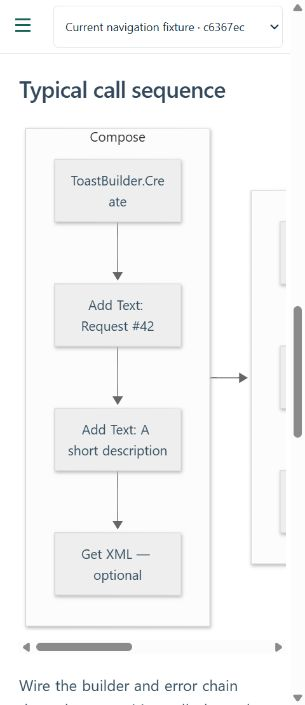
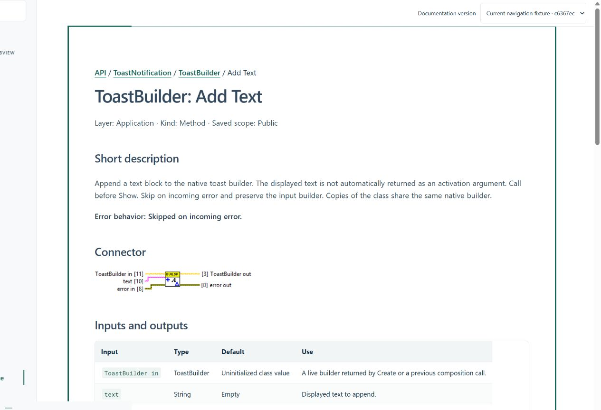

# Navigation review — issue #38

Reviewed 2026-11-02 in the in-app Chromium browser using viewport emulation,
not a physical phone. Source baseline: develop c6367ec. No LabVIEW file changed.

## Reproduced defect

At 390 × 844, clicking Menu leaves the drawer outside the viewport: its measured
left/right edges are approximately -300 / -20 px. Docsify's mobile stylesheet
sets `left: -300px`; the custom override translates the open drawer to zero
without resetting that offset. The closed/open definitions contradict each other.

## Changes

- Mobile drawer uses left zero and a full-width negative translation only when
  closed. Docsify still owns the toggle and its existing body class convention.
- Remove the main element's stacking context so the drawer is above the backdrop.
- Reserve a 56 px toolbar for the menu and version selector. Keep at least 44 px
  controls, visible focus, expanded state, controlled-navigation label and hidden
  drawer/content focus handling. Escape closes the drawer and restores toggle focus.
- Close on navigation or backdrop. Skip to content moves focus without changing
  the Docsify route. Desktop collapse/reopen still works.
- Docsify topMargin 72 keeps deep-link headings below the toolbar. Tables and
  diagrams scroll locally; narrow diagrams retain a readable minimum width and
  can receive keyboard focus.

## Observations

| Viewport | Scenario | Result |
|---|---|---|
| 390 × 844 | Pointer opens drawer; select ToastService | Visible drawer at left 0, named links usable, destination loads and drawer closes |
| 390 × 844 | Enter opens; Escape closes | Expanded state true/false; focus returns to sidebar-toggle |
| 390 × 844 | Backdrop activation | Drawer closes |
| 320 × 740 | Menu + version selector | Toggle x0–48, selector starts x56 with 44 px height; no overlap |
| 320 × 740 | Add Text tables and Mermaid | Document width 320; diagram scrolls inside 280 px region with 680 px content |
| 320 × 740 | Inputs and outputs anchor from drawer | Heading top approximately 72 px; main-content receives focus; route retained |
| 1280 × 900 | Sidebar close/reopen | State changes correctly; page width 1280 |
| 1280 × 900 | Keyboard skip link | Focus main-content; route stays /reference/toastbuilder/add-text |
| Local two-version fixture | Change ToastService version, then Back | /api/toastservice retained; previous/current selected labels verified |
| Local two-version fixture | Change Add Text to version without that page | Route retained; Page not found explicitly says unavailable in selected version |

The local fixture uses current staged docs and docs built from the saved #37
worktree, with manifests identifying both as fixtures. Only the previous fixture's
generated Add Text page is intentionally omitted to exercise the missing-page
path. No source VI or authored page is removed. Published branch checks use the
real version catalogue instead.

Build: strict saved-help URL and local-route checks pass. Existing Python
detailed-help regression checks pass. Viewport emulation does not establish
touch behavior on real iOS/Android devices or a full screen-reader audit.
