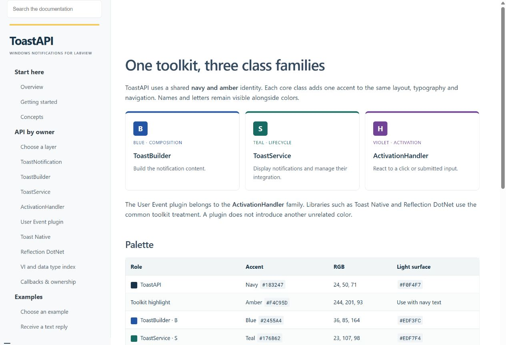
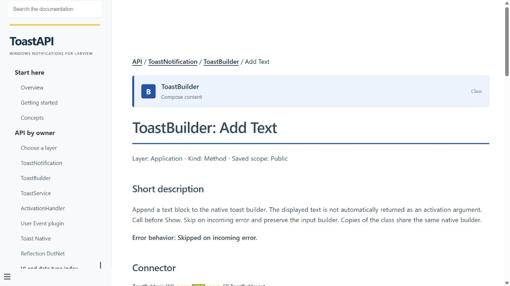
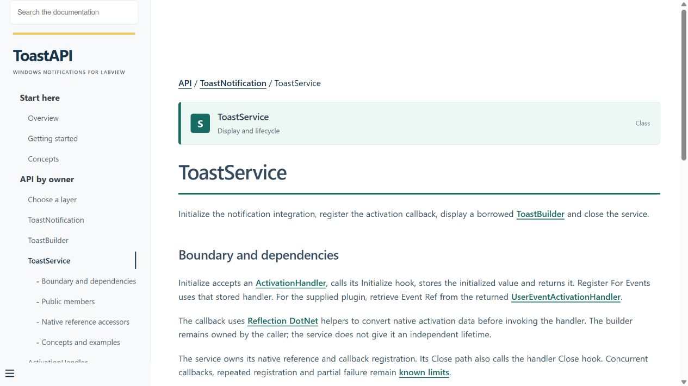
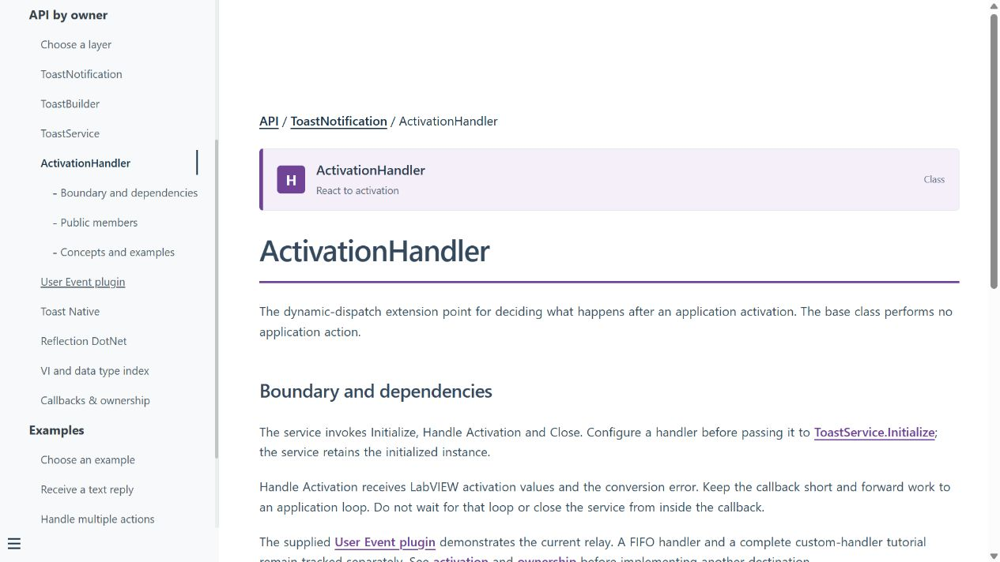
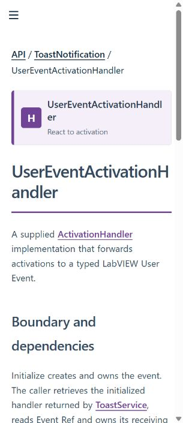
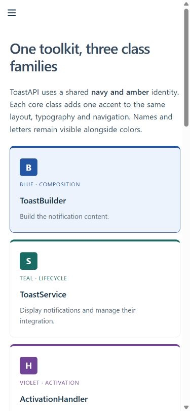

# Visual identity proposal — issue #39

Reviewed 2026-11-02 in the in-app Chromium browser. Mobile checks use viewport
emulation, not a physical phone. This proposal is layered on #38's navigation fix.

## Direction

One navy/amber toolkit identity, three class accents: Builder blue, Service teal,
Handler violet. The User Event plugin shares the handler family; low-level
libraries retain the common toolkit treatment. Full owner names and B/S/H
markers keep the distinction usable without color perception.

The short, public convention is [visual-identity.md](../site/visual-identity.md):
hex/RGB values, dark accents, light surfaces, class/VI banners, diagram treatment
and a possible future LabVIEW icon-banner application. No VI icon, class, library,
connector or diagram binary has been modified. Native exported PNGs are unchanged.

## Checks

- Actual inventory supplies the owner name and configured visual_family; no
  inference from member display names. Unrecognized families fail the build.
- Owner/method banners checked on ToastBuilder/Add Text, ToastService,
  ActivationHandler and UserEventActivationHandler. The plugin retains violet.
- At 320 px, the long plugin name wraps inside the 280 px banner; measured page
  width remains 320. At 390 px, all three cards stack at 350 px and page width
  remains 390. At 1280 px, three cards appear in a row and tables fill their frame.
- Mobile keyboard menu opens and navigation to ToastBuilder succeeds. Existing
  method/owner/example links remain available. Search still finds class/method entries.
- Diagram class calls use family borders and light fills, with their text labels
  retained. Native VI icon/terminal image is not recolored.
- Strict build, 10 detailed-help and 7 inventory checks pass. Building #38 sources
  with the current builder produces plain breadcrumbs without class banners;
  historical versions do not receive unstyled new presentation fragments.

Calculated relative-luminance contrast ratios (WCAG formula):

| Pair | Ratio |
|---|---|
| White / navy | 13.24:1 |
| White / Builder blue | 7.22:1 |
| White / Service teal | 6.33:1 |
| White / Handler violet | 7.15:1 |
| Navy / amber | 8.42:1 |

Accent links on white have the corresponding white/accent ratio. These checks
cover the specified principal text pairs, not a full accessibility certification.
Keyboard focus, names and underlines remain separate signals.

## Rendered proposal

The maintainer should review the palette before applying it to LabVIEW class
banners. This PR intentionally delivers a website proposal, not a VI migration.
