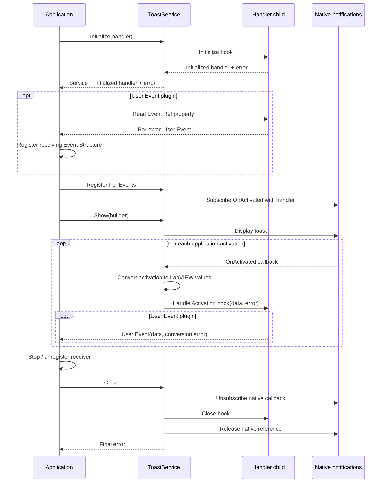

# ActivationHandler

The dynamic-dispatch extension point for deciding what happens after an application
activation. The base class performs no application action.

## Hooks orchestrated by ToastService

**Implement the hooks in a child class; call ToastService from your application.**
In the normal service workflow, do not call the handler's Initialize,
Handle Activation or Close yourself. ToastService invokes Initialize and Close;
its registered callback invokes Handle Activation for each application activation.
The initialized handler's runtime child class selects the overrides.

Initialize prepares the handler once; Handle Activation is invoked zero or more
times; Close releases its owned resources. The User Event property read and the
application's receiving registration are setup operations, not additional hook
calls. Read from the initialized handler returned by the service.

The shutdown order is the [service lifecycle contract](/reference/toastservice/close.md);
callback completion and repeated/partial cleanup remain
[known limits](/callbacks.md?id=shutdown-is-still-being-hardened).

## Boundary and dependencies

Handle Activation receives LabVIEW activation values and the conversion error.
Keep the callback short and forward work to an application loop. Do not wait for
that loop or close the service from inside the callback.

The supplied [User Event plugin](/api/usereventactivationhandler.md) demonstrates
the current relay. A FIFO handler and a complete custom-handler tutorial remain
tracked separately. See [activation](/concepts.md?id=activation) and
[ownership](/callbacks.md) before implementing another destination.

## Choose a hook

- [Initialize](/reference/activationhandler/initialize.md): return the initialized
  child value with the resources it needs for callback delivery.
- [Handle Activation](/reference/activationhandler/handle-activation.md): receive
  Activation and its conversion error, with no connector outputs.
- [Close](/reference/activationhandler/close.md): release child-owned resources
  while preserving the primary error.

The three base implementations perform no action. Error handling and delivery
are child responsibilities; the [User Event implementation](/api/usereventactivationhandler.md)
shows one concrete policy. A minimal custom handler implements these hooks and
exposes only the communication references needed by its caller.

<!-- API-MEMBERS -->
