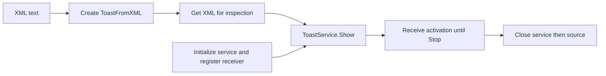

# ToastFromXML

Create a concrete [ToastSource](/api/toastsource.md) from XML text. The class
retains a parsed WinRT XML Document and implements Show, Get XML and Close.
No native references cross the application API.

## Choose your content source

Compose a notification with [ToastBuilder](/api/toastbuilder.md), export its XML,
then pass that text to Create ToastFromXML when you want to reuse the content.
The creation polymorph exposes both constructors; ToastService accepts either
source without changing the activation handler or receiving loop.

## Ownership and errors

The caller owns Close. Copies share the same document; do not use any copy after
the owner closes it. Show creates temporary notification/notifier objects and
releases them after the call, while retaining the document for further use.
Get XML returns ordinary text, possibly normalized by DOM serialization.

Creation, Get XML and Show skip work on incoming error. Close attempts release
even on incoming error and preserves that primary error. The constructor's
partial-failure path still needs hardening: a document created before Load XML
fails is not guaranteed to be released. See [known limits](/coverage.md).

## Scope

The constructor accepts a string, not a path. Save/read text with application
file I/O if needed. Template substitution and dedicated persistence methods remain
separate work. XML parsing does not guarantee toast-schema validity or Windows
rendering. Start with the [XML example](/guides/xml.md).

<!-- API-MEMBERS -->
