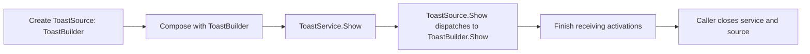

# ToastSource

The base class defines the common display, XML export and cleanup contract.
[ToastBuilder](/api/toastbuilder.md) derives from it and owns the native builder.
The base class does not own a native notification resource or compose content.

## Create a concrete source

Use [Create ToastSource (Poly)](/reference/toastnotification/create-toastsource-poly.md)
and select its concrete creation instance. The current instance is
[Create ToastBuilder](/reference/toastbuilder/create-toastbuilder.md).
Its output keeps the ToastBuilder type so composition methods remain available.
The polymorphic VI selects a creation VI; it is not a runtime source factory.

## Common operations and ownership

Pass the configured source to [ToastService.Show](/reference/toastservice/show.md).
The service invokes `ToastSource.Show` dynamically, so the concrete class supplies
the implementation without a type switch in the service.

The caller owns the source and closes it after its last use. The service borrows
it for Show and does not store or close it. Copies of a ToastBuilder continue to
share its native handle; using the parent type does not create a second owner.
Service.Show has no source output and does not retain the source value returned
by its Show implementation. A new implementation must account for that boundary;
do not expect a changed by-value field to be returned to the application by the service.

## Implementing a source

Override `Show`, `Get XML` and `Close` with matching connectors. Show and Get XML
skip work on incoming error; Close implementations must attempt resource cleanup
even on incoming error and preserve the primary error.

The current base methods contain no native work: Show is a no-op, Get XML returns
an empty string, and Close propagates the error without releasing anything.
Use a created concrete source, rather than a bare ToastSource, in application code.
Do not rely on the base methods to report an uninitialized-source error.

ToastBuilder currently supplies all three overrides. XML loading through
the future `ToastFromXML` class remains separate work in
[issue #28](https://github.com/loicwoh/ToastNotifications/issues/28); disk templates
remain in [#29](https://github.com/loicwoh/ToastNotifications/issues/29).

<!-- API-MEMBERS -->
