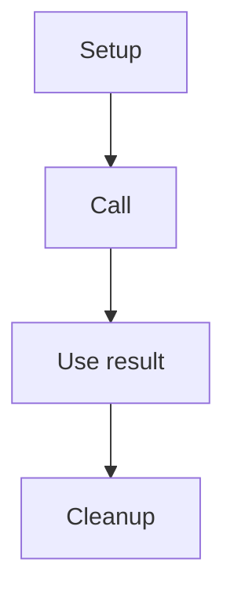

<!-- Maintainer scaffold: start at H2; the builder supplies the title, saved
summary and compact error behavior. Keep review evidence in the adjacent JSON,
not in the public page. See ../README.md. -->

## Connector

<!-- Use LabVIEW's native documentation/Context Help image with the actual VI icon
and named terminals. Export or capture it; do not redraw the connector grid.
Keep the image beside this Markdown and provide meaningful alt text. -->

## Inputs and outputs

| Input | Type | Default | Use |
|---|---|---|---|
| Replace | Replace | Distinguish saved default from a usable runtime value | Replace |

| Output | Type | Use |
|---|---|---|
| Replace | Replace | State aliases, ownership and returned-error meaning |

## Typical call sequence

<!-- Use a Mermaid flowchart. Show setup, call, result/lifetime and cleanup.
Add only the wiring or prerequisites that the diagram does not convey.
Link an existing executable example. Do not repeat each diagram step in prose. -->

## Usage notes

<!-- Keep only meaningful constraints, validation, errors, pitfalls and ownership.
The generated error cue uses error_behavior=skip or always. Use the same compact
wording in the VI context-help summary when an authorized VI documentation edit
is made: "Skipped on incoming error." / "Executes even on incoming error."
For always methods, explain error merging if needed. No internal node-by-node
description unless the caller needs it. Link the canonical ownership contract. -->

## Related reading

<!-- Link owner, concepts, neighboring VIs, executable example and Microsoft.
Keep LabVIEW inspection version, export method, hashes and evidence in JSON/PR.
Do not add validation or provenance sections to the public help. -->